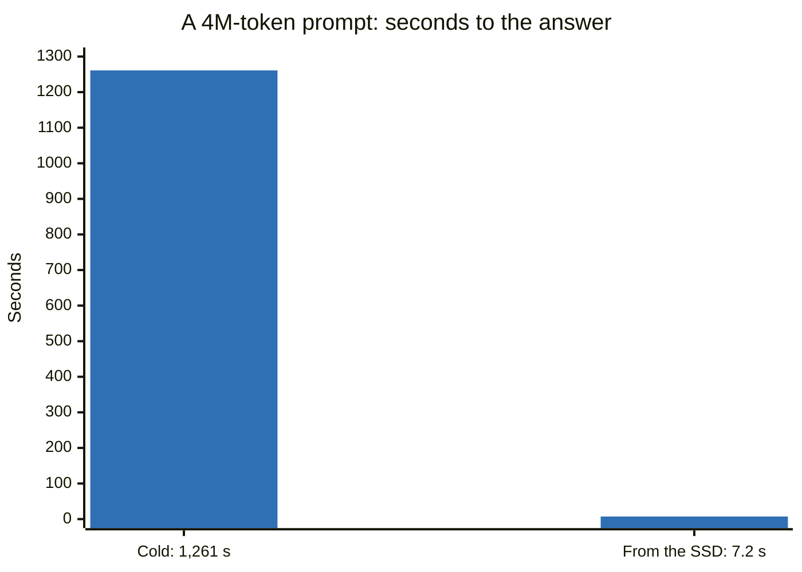
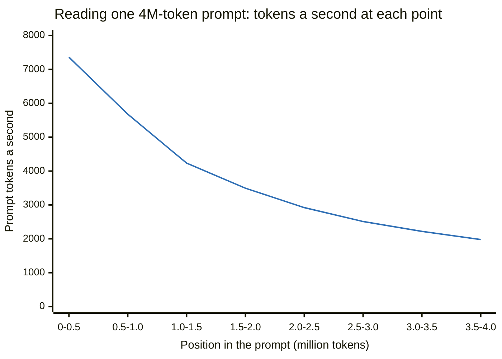

# Long context: 1M, 2M and 4M tokens

DeepSeek trained V4.1-Flash up to 1,048,576 tokens, stretching its positions with YaRN (factor 16 over the 65,536 the base
model saw). This repository can stretch them further at start:

| Window | Start with | KV pool (positions for all conversations) | Longest request |
|---|---|---:|---:|
| 1M (the checkpoint's own) | `./start.sh` | about 18.3M | 1,048,526 tokens |
| 2M | `CONTEXT=2097152 TF_DS_YARN_FACTOR=32 ./start.sh restart` | about 16.8M | 2,097,102 |
| 4M | `CONTEXT=4128768 TF_DS_YARN_FACTOR=64 ./start.sh restart` | about 13.5M | 4,128,718 |

A request may use the window less 50 tokens. `TF_DS_YARN_FACTOR` makes the engine read rotary-position tables built for
that factor (the default kernel kit follows it: the first start at another factor fetches that kit and makes its tables)
and allows the longer window; unset, the engine runs the checkpoint's factor 16 and the 1M window. The longer windows'
position tables and buffers take memory the KV pool would otherwise hold, which is why the pool shrinks as the window
grows.

A conversation takes pool positions for its own length, not the window's. By the pool's arithmetic, about 17
conversations of the full 1M length fit at once (`PARALLEL`, 16 by default, caps the requests at once), 8 of 2M, or 3 of
4M. Several long conversations at once have not been tested.

**Why 4,128,768 and not 4,194,304.** When writing a reply, the indexer (the part of DeepSeek's attention that picks which
earlier tokens each token reads) runs one GPU block per 64 earlier tokens along a grid axis limited to 65,535 blocks, so a
window holds at most 65,535 x 64 = 4,194,240 tokens. Its ready-built kernels also take only sizes divisible by 16, which a
window keeps when it is a power of two or a whole number of 65,536-token steps. The largest such window under 4,194,240 is
63 x 65,536 = 4,128,768 tokens (`zig/src/families/dsv41/config.zig`). At start the engine refuses a window that breaks
either rule and names one that works.

## Does it find things?

Codes hidden in a long filler text, each tied to a city; the question at the end asks for them. Greedy decoding
(temperature 0), thinking off, one request at a time. Every code came back right at every length and depth tried:

| Window | Prompt tokens | Test | Found | Seconds |
|---|---:|---|---:|---:|
| 1M | 997,530 | one code at 0 / 50 / 100 % depth | 3 / 3 | 157 |
| 2M | 1,995,034 | one code at 0 / 25 / 50 / 75 / 100 % depth | 5 / 5 | 426 |
| 2M | 1,995,164 | ten codes in one prompt (at 5, 15 ... 95 %) | **10 / 10** | 427 |
| 2M, Turbo | 1,995,164 | ten codes in one prompt | **10 / 10** | 418 |
| 4M | 3,990,287 | twenty codes planted, ten asked, cold | **10 / 10** | 1,261 |
| 4M | 3,990,312 | the same prompt, all twenty asked, after an engine restart, from the SSD tier | **20 / 20** | **7.2** |

The last row is the SSD tier at work. The first 4M request read all 3.99M tokens (21 minutes), and the tier wrote that
state to each Spark's disk within 5 s of the answer. The engine was then stopped and started again, which empties its
memory, and the same prompt came back with a different question at its end. The tier restored the state of the first
3,989,504 tokens in 664 ms, the engine read only the 808 new tokens, and the model answered all twenty: 175 times faster
than reading the prompt again.



**Run it yourself** (the tools need only Python's standard library; with keys on they read `API_KEY` or `API_KEY_FILE`):

```bash
tools/needle_test.sh 1m     # the 1M window: one code at 0-100 % of 128K and 1M, ten codes in one 128K and one 1M prompt (~20 min)
CONTEXT=2097152 TF_DS_YARN_FACTOR=32 ./start.sh restart
tools/needle_test.sh 2m     # the 2M window: one code at 128K, 1M, 1.5M and 2M, ten codes at 128K, 1M and 2M (~1 h 30 min)
# twenty codes in one ~4M prompt, ten asked cold, then all twenty from the SSD tier (the same seed sends the same prompt):
CONTEXT=4128768 TF_DS_YARN_FACTOR=64 ./start.sh restart
python3 tools/multi_needle.py --lens 4000000 --needles 20 --ask 10 --seed 1 && ./start.sh restart && \
python3 tools/multi_needle.py --lens 4000000 --needles 20 --ask 20 --seed 1
```

The times above are cold: for the needle sets start with `PROMPT_CACHE_GIB=0 SPILL_GIB=0`. The 4M pair needs the SSD tier
for its second request, so leave `SPILL_GIB` at its default for it.

## Does it reason over it?

Finding one code is not reasoning. MRCR asks for more: a long chat in which two (or eight) turns answer the same request
with different texts, and a last question asking for the first or the second of them. The model must keep near-identical
passages apart and put them in order. Measured with [`tools/reason4m`](../tools/reason4m/README.md) on this engine (stock
weights, the served settings, one question at a time, temperature 1.0); the score is the suite's own match ratio, with
its standard error.

**Google's MRCR v2, two passages** (questions about one transcript per length, each length on its own window: 1M on the
served window, 4M on the 4M window; the suite's published noise rate, what answering with one of the two passages at
random scores, is about 51 %):

| Prompt | Thinking off, 80 questions | Thinking off, 20 of them | Thinking on (high), the same 20 |
|---|---:|---:|---:|
| 1M (the served window, factor 16) | 50.9 % (± 5.4) | | |
| 4M (the 4M window, factor 64; about 4,010,000 tokens) | 36.0 % (± 5.1) | 42.7 % (± 10.7) | 80.3 % (± 9.1) |

With thinking on, replies that reached the 16,384-token budget count as wrong (2 of the 20 at 4M).

**OpenAI's MRCR, eight passages** (the set's 524K-1M conversations, 20 of them, each read cold; the served 1M window;
scored with that set's own rule): thinking off 43.9 % (± 10.5), high 54.9 % (± 10.3), max 50.8 % (± 10.2).

What this shows: without thinking, the model finds and copies the passages, but over 80 questions it orders them at about
the noise rate at 1M and below it at 4M. With thinking, on the same 20 questions, the score at 4M rose from 42.7 % to
80.3 % (a gain of 37.6 points, ± 14.7). Twenty questions about one transcript are a small sample: these are
measurements of this engine, and the model's card publishes no result on these sets.

**LongBench v2, its long items** (THUDM's multiple-choice questions on real documents: code repositories, books,
reports, tables, many worked examples; the 108 items of its "long" bin; [`tools/longbench2.py`](../tools/longbench2.py)
with the authors' prompt, temperature 0.1 and 128 reply tokens, thinking off; the 32 items longer than the served 1M
window cut in the middle to 1,024,000 tokens by the model's tokenizer, as the authors cut theirs (the chat template
adds a few dozen more); the shipped settings; one run; every reply is in
[`evidence/native-8c6e8e88d875/`](../evidence/native-8c6e8e88d875/)): **55 of 108 right, 50.9 % (± 4.8)**, where a
random letter scores 25 %.

| Items (the set's own groups) | Right | Score |
|---|---:|---:|
| easy | 29 of 45 | 64.4 % (± 7.1) |
| hard | 26 of 63 | 41.3 % (± 6.2) |
| Code Repository Understanding | 19 of 29 | 65.5 % (± 8.8) |
| Long In-context Learning | 15 of 26 | 57.7 % (± 9.7) |
| Long Structured Data Understanding | 5 of 6 | 83.3 % (± 15.2) |
| Multi-Document QA | 9 of 23 | 39.1 % (± 10.2) |
| Single-Document QA | 7 of 24 | 29.2 % (± 9.3) |

Eleven replies began working through the question and reached the 128-token limit before naming a letter; the authors'
rule counts them wrong (of the 97 that named one, 56.7 % were right). The cut items scored 21 of 32, the whole ones 34 of
76. The prompts ran from about 171K to 1.02M tokens (median 445K), one item at a time, a median of 70 s each. The
score shows that the model reads and uses real documents of these lengths; it ranks it against no other model, since
the model's card publishes no LongBench v2 result to set it against, and its ± is the sampling error of one run.

## How fast a long prompt reads

The speed at each point of one prompt (tokens a second over each stretch; the engine's own count of prompt tokens finished,
read every second, on four Sparks; a separate run of the prompts above):

| Position in the prompt | 2M, Turbo off | 2M, Turbo on | 4M |
|---|---:|---:|---:|
| 0 - 0.5M | 7,255 | 7,580 | 7,360 |
| 0.5 - 1.0M | 5,743 | 5,837 | 5,678 |
| 1.0 - 1.5M | 4,129 | 4,165 | 4,234 |
| 1.5 - 2.0M | 3,385 | 3,385 | 3,494 |
| 2.0 - 2.5M | | | 2,922 |
| 2.5 - 3.0M | | | 2,511 |
| 3.0 - 3.5M | | | 2,221 |
| 3.5 - 4.0M | | | **1,980** |
| whole prompt | 4,726 (424 s) | 4,795 (418 s) | 3,174 (21 min) |



A long prompt slows as it goes. Each token's attention uses only 512 earlier tokens, but, as we read the model's design,
the indexer scores every earlier token to choose them, so that work grows with the position: measured here, each token
costs about 110 µs plus about 106 µs for every million tokens before it. Writing a reply pays the same scan: one request
runs about 15.5 steps a second 4M tokens deep, against about 35 at short lengths.

## What it costs, and what it does not show

- **Pool positions**: the longer windows' position tables and buffers take memory the KV pool would otherwise hold (the
  first table above). With Turbo at the 2M window the pool holds 9,043,968 positions against 16,842,752 (46 % less), for
  no gain past about 1.25M tokens (the speed table above).
- **Factors 32 and 64 are not the checkpoint's position encoding**, at any length: YaRN's factor changes the slow rotary
  frequencies and the attention scale at every position, so replies can differ from factor 16's even on short prompts.
  Both are off by default; turn one on when you need more than 1M.
- **Finding is not reasoning.** The needle tests show the model finds and quotes facts anywhere in 4M tokens. Keeping
  near-identical passages in order needs thinking on (above); the model was never trained past 1M, and these sets cover
  ordering, not every kind of reasoning across that much text.
